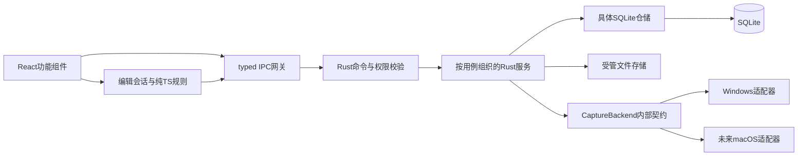
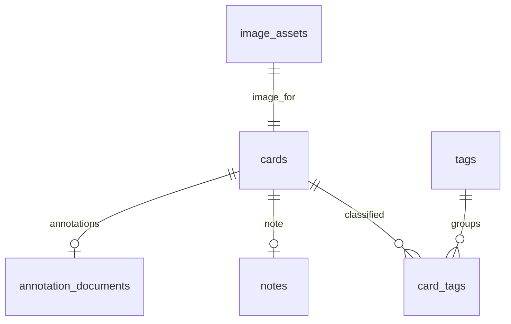
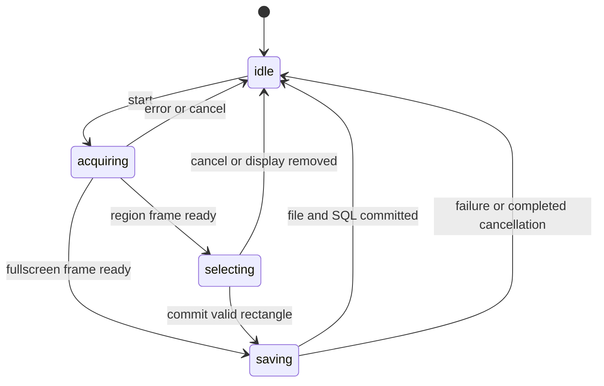

v4.4.0开发验收：当前PDF30,000条Zotero标准批注、schema21缓存扩容、批量原子比较和有界DOM/密集绘制；[规模决策](architecture/ZOTERO_ANNOTATION_SCALE_440.md)。用户明确停止IDE开发，前序研究不接入主应用。

v4.2.7 Step16：沿用模块化单体与现有Zotero适配，schema20增量保存标准批注待处理意图、处理修订和来源刷新设置；详见[同步决策](architecture/ZOTERO_ANNOTATION_SYNC_STEP16.md)与[实际验收](qa/RELEASE-4.2.7.md)。

v4.2.6 Step15：复用Zotero只读适配和schema19，增加官方Local API受控授权与写入、条件版本和复读确认；详见[写入决策](architecture/ZOTERO_ANNOTATION_WRITES_STEP15.md)与[实际验收](qa/RELEASE-4.2.6.md)。

# ResearchClip 架构设计

5.0.0候选：Windows工作台原生内嵌WebView2浏览器，独立WS_CHILD、main视图精确能力、原编辑会话保留；无数据库迁移及新依赖。见[浏览器决策](architecture/RESEARCH_BROWSER.md)和[本轮检查](qa/BROWSER_WORKSPACE_500.md)。

v4.2.5 Step14：只读ZoteroAnnotationIdentity/Repository/CoordinateAdapter/ReadCache，SQLite19派生缓存、GET-only及原件授权，来源冲突停止叠加。见[只读适配](architecture/ZOTERO_ANNOTATIONS_STEP14.md)及[实际验收](qa/RELEASE-4.2.5.md)。

v4.2.4 Step13：截图回跳、PDF文字引用、区域反向笔记与受管副本逐次校验；SQLite18派生边与原链接共用CAS事务和源文校验。见[双向定位](architecture/PDF_BIDIRECTIONAL_STEP13.md)及[实际验收](qa/RELEASE-4.2.4.md)。

v4.2.3 Step12：PDF.js按页选区与独立DPI渲染，SQLite17扩展既有截图写入意图和统一PdfLocation，复用标注、Markdown文件/撤销/相对图片管线。文档边界标记只用于已有块投影；不另建资源或正文服务。见[坐标、权限和迁移设计](architecture/PDF_EXCERPTS_STEP12.md)与[验收记录](qa/RELEASE-4.2.3.md)。

v4.2.0 Step11：复用单实例和PDF会话，原生argv授权队列、只读Zotero来源预览/确认，SQLite16扩展既有范围映射；详见[Step11架构](architecture/ZOTERO_PDF_STEP11.md)与[实际验收](qa/ZOTERO_PDF_STEP11.md)。v4.1.9已提供[原生PDF阅读器](architecture/PDF_READER_STEP10.md)。下文保留各阶段原有记录。

v4.1.5用户Step06：有界表格局部编辑、图片组与旧caption图题、代码HAST安全着色、视图行号/折叠及最近格式；复用原文、资源与文件/撤销服务。无迁移/权限扩张，见[设计](architecture/MARKDOWN_STEP06_DESIGN.md)与[验收](qa/MARKDOWN_STEP06.md)。

v4.1.4 Step05：原文投影、局部差量写回、四视图、比例同步、六斜杠动作及原块拖动；未引入第二正文/撤销/文件服务或新运行依赖。SQLite12，比较与边界见[先行选型](architecture/EDITOR_STEP05_DECISION.md)，实际结果见[Step05验收](qa/MARKDOWN_STEP05.md)。

v3.1.8 A12：7种类型化动作、单运行有限执行器、检查点和显式校对；复用截图/OCR/公式/Markdown与设置文件，保留全局键冲突检测。无新依赖、数据库迁移、脚本或自动执行权限，见[命令与工作流](COMMAND-WORKFLOWS.md)。

v3.1.7 A11：schema10独立保存原像素点/区域锚点，绑定截图稳定ID与原图SHA256；main-only有界命令、乐观锁及A10索引扩展。Markdown跳转复用编辑器会话与viewport，不重开右侧文档；普通副本导出保留可读区域说明。无新依赖或系统协议注册，契约见[图片锚点](ANNOTATION-ANCHORS.md)。

v3.1.5 A10：复用文档/截图稳定ID；schema9持久链接索引与文档标签，保存后后台CommonMark worker解析、摘要校验及事务替换。SVG图谱和受管相对链接导出复用既有文件/状态服务。协议、边界见[内部链接](INTERNAL-LINKS.md)，实测见[验收](qa/RELEASE-3.1.5.md)。

v3.1.0：WebDAV沿用资源协议与schema6。`sync_configure`异步本机写入后返回经验证的Status；Zustand区分mutation busy、状态读取与停止请求，合并状态轮询并以generation丢弃过期响应。启动/冲突处理用spawn_blocking，取消AtomicBool先送达、job.try_lock只更新提示，不阻塞UI等待配置锁；前端对先于启动回执的取消再送一次以保留取消意图。`form.ts`仅做字段/凭据身份校验，后端安全验证继续独立执行。表单不因轮询remount，不持久化未保存密码。凭据读取失败返回受控错误供重输，不回退明文。无权限、依赖或数据库变更；[实际验收](qa/RELEASE-3.1.0.md)。

v0.1.5：`features/document/templates.ts` 提供普通 Markdown 模板种子，复用现有 Zustand 文档会话、未保存确认及文件服务；选择模板后才创建文档，不改变 WorkspaceSplit 的条件挂载。`TemplateDialog` 通过 main-only 的5个有界命令访问 `TemplateFiles`，应用配置目录 `templates-v1/<id>/名称.md + assets` 与 SQLite/用户文档独立。创建在暂存目录校验并提交，重命名复用 DocumentFiles 的禁止覆盖和变更检查；删除采用独立目录改名归档。模板加载的内部文件授权随临时 DocumentFiles 释放，不作为新文档保存路径。`outline.ts` 使用现有 CommonMark 解析链中的 mdast 工具，源文 UTF-16 偏移与预览 heading position 对齐；镜像文本布局处理软换行后的定位，不把导航当作正文编辑。实际契约及验收见 [0.1.5](qa/RELEASE-0.1.5.md)。

v0.1.4：Annotation v1 新增 mosaic/blur/number，由前后端共同校验；effects.ts 共用原像素滤镜、底图区域 clip/copy 替换及矢量上层渲染。复用编辑器 state/history/serialization/export，不改数据库 schema。对象范围、预算、透明度与实际检查见 [高级标注验收](qa/RELEASE-0.1.4.md)。

2026-10-17 v0.1.3：新增本地 `OcrService` 平台边界、main-only 有界 PNG OCR/文字复制命令和 `features/ocr` 单会话面板。Windows.Media.Ocr 经本机探针确认；整图/原图像素选区、标注合成复用和显式 Markdown 插入，不变更数据库或原图。线程门控、语言包、资源释放和真实识别限制见 [OCR 验收](qa/RELEASE-0.1.3.md)。

2026-10-17 v0.1.2：工作区改为左侧主要截图操作、两行顶部搜索/文档工具栏和圆角内容容器，深浅蓝灰主题由既有 CSS 角色及 useAppearance 驱动。不引入新框架或远程字体，设置和编辑会话模型不变；布局、原生回归及发布记录见[0.1.2 验收](qa/RELEASE-0.1.2.md)。

2026-10-17 新增桌面贴图：主窗口上传有界 PNG 快照至 PinManager，独立 `pin-*` WebView 按自身窗口身份读取；截图和编辑器分别复用已有预览 PNG / 原分辨率 renderComposite。`features/pins` 管界面、`commands/pins.rs` 管受限 IPC、`services/pins.rs` 统一管原生窗口和资源；不改 SQLite 或标注格式。主窗口隐藏时保留、退出成功时销毁全部贴图，Destroyed 释放资源。物理尺寸、内存预算、专用 capability、Windows 透明度及实际验收范围见[桌面贴图契约与验收](PINS-VALIDATION.md)。

2026-10-16新增图文Markdown文档契约见第14节；与第12节既有卡片原图导出并存，不替换数据库或编辑器数据模型。

正式规划 v1，2026-10-12。本文覆盖首发目标；“当前主界面”与“现有M1”段落描述已有代码，其他接口、业务表和未来目录都是设计，不能视为可调用API、已创建数据库或已验证的截图功能。产品范围见 [PRD](PRD.md)，通过条件见 [ROADMAP](ROADMAP.md)。

## 1. 技术判断与原则

指定栈可支撑本地桌面截图、编辑与知识管理。采用模块化单体：React负责交互和Konva渲染，少量纯TypeScript负责编辑规则，Rust负责系统能力、持久化和生命周期。SQLite现已保存素材、标注和笔记/标签数据，当前实际契约见第10节；偏好为独立版本化JSON，Zustand只管理界面/编辑会话。下文较早首发业务表与迁移阶段仍是完整MVP规划，不代替第10节源码事实。首发不引入额外服务进程、ORM、DI容器或事件溯源。

全局热键与截图是两个能力：官方 [Global Shortcut插件](https://v2.tauri.app/plugin/global-shortcut/)提供注册/触发；实际图像由原生适配器取得。当前托盘采用 [Tauri System Tray](https://v2.tauri.app/learn/system-tray/)，单实例采用官方 [Single Instance插件](https://v2.tauri.app/plugin/single-instance/)2.5.3；已安装global-shortcut、clipboard-manager、dialog和opener沿用。桌面生命周期实际契约见第13节。

Windows M2A原设计优先实验DXGI Desktop Duplication；最新请求的全屏预览原型采用微软 [windows-rs](https://github.com/microsoft/windows-rs) 0.62.2直接调用Win32 GDI。方案核对、xcap评估和实际验收见 [全屏截图验收](SCREEN-CAPTURE-VALIDATION.md)。这不代表DXGI或完整M2A矩阵已经验收，不同时铺设多个后端。macOS M6评估ScreenCaptureKit，复用项目内部契约。

## 2. 组件、业务层与存储的关系



| 层 | 责任 | 数据与约束 |
| --- | --- | --- |
| React组件 | 视图、输入、可访问性、错误/脏状态展示 | 不写SQL，不直接操作用户文件，不把Konva节点当持久化数据 |
| TS业务规则 | 图元编辑、坐标转换、撤销重做、文本验证 | 纯函数可单测；一次手势提交一个操作；图像像素不进入history |
| Zustand | 页面、选择、视口、编辑草稿、连接状态 | 与已保存revision分开；不可替代数据库；不把科研内容写localStorage |
| IPC网关 | 集中invoke与事件订阅、DTO校验、错误映射 | unknown响应先验证；注销事件监听；请求/事件带sessionId防止过期响应 |
| Rust命令 | 参数、窗口权限、资源上限与版本校验 | 薄入口；不接受任意SQL或图像路径；不混入绘图UI逻辑 |
| Rust用例服务 | 捕获会话、保存卡片、保存编辑、搜索、导出、设置/退出 | 协调短SQL事务和文件提交；耗时任务离开UI线程 |
| SQLite仓储 | 参数化查询、约束、迁移、revision更新 | 使用具体结构/函数，不为每个表制造抽象trait |
| 文件服务 | 原图不可变落盘、缩略图、导出暂存 | UUID路径、禁止覆盖、根目录检查；与数据库一致性需要恢复策略 |
| 原生适配器 | 显示器、权限、像素帧、平台错误 | 不创建卡片或写DB；不依赖React/Konva |

当前主界面采用App + Sidebar/Toolbar + 按导航选择的功能视图，不引入路由框架。app/ui-store保存导航与当前外观；features/settings/store经 typed IPC 读取/写入 Rust SettingsService 的设置 JSON，没有浏览器持久化中间件。原app/store继续管理getVersion/test_connection；真实通信检查位于设置页。useAppearance通过CSS变量切换主题，桌面端调用Tauri Window.setTheme同步标题栏。弹窗使用原生dialog提供键盘焦点约束和Esc关闭，Lucide统一图标。素材与收藏展示真实SQLite分页数据，标签管理与科研知识卡片已接入；新建截图已接入全屏预览及区域截图命令。区域原生交互已在记录的 Windows 主屏 100% 配置通过，其他硬件矩阵未完成；搜索采用真实SQLite组合查询，不创建伪数据。

get_workspace_status保留为显式诊断，当前UI通过library_status与screenshot_page访问工作区；首次调用时打开SQLite并进行版本检查和恢复。最初界面记录见 [主界面验收](MAIN-UI-VALIDATION.md)，当前数据契约见第10节，M1历史结果见M1-VALIDATION/INITIALIZATION-VALIDATION。未来服务按阶段添加，不把M1重写成框架。截图/D3D/COM若有线程亲和，由所属后台线程创建和使用；不强制原生对象实现Send+Sync。SQLite锁只包裹短查询/事务，不持锁等待帧、编码、用户确认或导出渲染。

### 前端功能组件规划

| feature | 主要组件 | 业务逻辑位置 |
| --- | --- | --- |
| capture | CaptureOverlay、SelectionBox、CaptureStatus | 单屏框选与逻辑→像素转换；原生捕获仍在Rust |
| editor | EditorView、AnnotationCanvas、EditorToolbar、StylePanel、TextInputOverlay | editorModel、history、viewport；图元JSON驱动Konva |
| library | LibraryView、CardGrid、CardItem、CardDetail、TrashView | 列表筛选、分页、卡片动作与错误反馈 |
| notes | NoteEditor | 原始Markdown编辑、脏状态、保存冲突 |
| tags | TagPicker、TagManager | 关联和编辑UI，最终唯一性由Rust/SQLite校验 |
| settings | SettingsView、ShortcutField | 用户配置输入与注册失败反馈；托盘/退出由Rust管理 |
| export | ExportDialog | 导出模式、保存前确认、进度与错误 |

不强制每个小组件立即拆文件；达到实际复杂度再拆。feature通过shared/api与后端协作，避免互相导入内部store。通用Modal/Button等真正重复后才进入shared/ui。

## 3. 项目目录

以下为目标目录。M1现有文件保留；标“后续”的模块按请求创建，不生成无作用stub。

```text
ResearchClip/
  README.md
  AGENTS.md
  docs/
    PRD.md
    ARCHITECTURE.md
    ROADMAP.md
    M1-VALIDATION.md           # 保留历史事实
  src/
    app/
      App.tsx
      store.ts                # 初始化、通信状态
      ui-store.ts             # 当前界面会话状态，不持久化
      use-appearance.ts       # CSS主题与Tauri标题栏同步
      layout/                 # 当前侧栏、工具栏、入口弹窗
    features/
      home/                   # 当前欢迎引导
      capture/                # 当前全屏预览、CaptureOverlay、geometry/测试
      editor/                 # 当前画布、model/history、项目与合成导出
      library/                # 当前真实缩略图卡片、分页、排序和操作
      notes/                  # 当前科研知识卡片与自动保存
      tags/                   # 当前标签管理与素材筛选
      settings/               # 当前持久化外观、视图、双快捷键、保存目录与通信检查
      export/                 # 当前Markdown导出协调、状态与批量选择
    shared/
      api/                    # typed IPC，按业务扩展文件
      types/                  # DTO与标注文档类型
      ui/                     # 复用组件
    main.tsx
    styles.css
  src-tauri/
    src/
      lib.rs                  # 组装状态、窗口和命令
      main.rs
      commands/               # 薄IPC入口
      domain/                 # DTO、业务校验、错误
      services/               # 当前screen_capture/region_capture；后续业务用例
      capture/                # 当前mod.rs/windows.rs/geometry.rs；后续backend契约
                              # macos.rs在M6实现
      storage/                # 现有迁移；后续具体仓储、files.rs
    migrations/               # 顺序SQL，已发布文件不可随意改写
    capabilities/             # 按窗口最小权限
    icons/
    Cargo.toml
    Cargo.lock
    tauri.conf.json
  scripts/                    # 现有工具链包装和冒烟
  assets/                     # 图标源等构建资料
  package.json
  package-lock.json
```

单测靠近对应TS/Rust逻辑；少量跨模块测试在需要时放tests/。构建产物、artifacts、.tools及用户资料保持忽略。新目录不意味着新服务进程或独立package。

## 4. 数据模型

### 4.1 通用约定

- 主键UUID字符串，时间为UTC Unix毫秒，JSON使用camelCase，SQL使用snake_case。
- 文件路径相对于受管数据根目录，用正斜杠保存；不能包含绝对路径、..、Windows设备名或越界符号链接。导出目标来自受限文件选择流程。
- 图像尺寸为原图物理像素；原图保存后不可改写。所有图元数值有限，不接受NaN/Infinity。
- DB schema版本（PRAGMA user_version）、文档schemaVersion和编辑revision分别管理；三者不是同一个版本号。
- 当前M1仅app_metadata(key TEXT PRIMARY KEY, value TEXT NOT NULL)，保存workspace_initialized_at，user_version=1。以下业务表尚未创建。

### 4.2 目标表与字段

| 表 | 字段（目标） | 关系、约束与生命周期 |
| --- | --- | --- |
| image_assets | id TEXT PK；original_relpath TEXT UNIQUE；mime_type TEXT；width_px/height_px INTEGER；byte_size INTEGER；sha256 TEXT；capture_metadata_json TEXT；created_at INTEGER | 首发PNG；宽高/字节数>0；SHA-256为64个十六进制字符；capture JSON验证版本与范围；原图不可变；首发不做哈希去重 |
| cards | id TEXT PK；image_asset_id TEXT UNIQUE FK；title TEXT；revision INTEGER；created_at/updated_at INTEGER；trashed_at INTEGER NULL | 一卡一张原图；资产删除RESTRICT；revision>=0；title 1–200个Unicode标量；回收站保留所有关联 |
| annotation_documents | card_id TEXT PK/FK；schema_version INTEGER；revision INTEGER；document_json TEXT；updated_at INTEGER | 一卡一个文档，首次采集创建空文档的机制在M3接入；JSON合法且类型/尺寸/version经过领域验证 |
| notes | card_id TEXT PK/FK；markdown TEXT；revision INTEGER；updated_at INTEGER | 一卡0或1笔记；首次保存建立；空笔记可保留；首发不做独立笔记或HTML持久化 |
| tags | id TEXT PK；display_name TEXT；normalized_name TEXT UNIQUE；created_at/updated_at INTEGER | 1–50个Unicode标量；trim/NFKC后非空，再将ASCII字母小写；显示名保留输入；不做语义合并 |
| card_tags | card_id TEXT FK；tag_id TEXT FK；created_at INTEGER；联合PK(card_id, tag_id) | 关联不可重复；硬删除tag可CASCADE关联；不级联删卡片 |
| app_settings | key TEXT PK；value_json TEXT；updated_at INTEGER | 已知key和类型白名单；快捷键/默认显示器/关闭行为/导出模式；未知key不静默丢弃 |

FK开启；notes/annotation_documents/card_tags的card FK可CASCADE，但首发卡片动作仅更新trashed_at，不执行硬删除。未来永久删除必须是独立请求、显式用户操作与文件清理策略。业务SQL采用STRICT和必要CHECK；不能只靠JSON合法性保证领域有效性。



目标关系在MVP中稳定；M2尚未接入标注表，M3后新卡片需同步建立空文档，旧卡片升级时补齐。笔记和标注各有revision，避免保存笔记覆盖刚保存的图元。标题/回收站更新用cards.revision；同一事务更新card.updated_at用于排序。

索引先保留cards(trashed_at, updated_at DESC, id)和card_tags(tag_id, card_id)。image_assets的路径/外键唯一约束自带唯一索引。不提前增加每字段索引。

搜索使用参数绑定的字面子串查询：转义%、_、反斜杠后LIKE，针对ASCII大小写规则使用显式规范化；中文按原文匹配。标签筛选AND，搜索范围OR，用EXISTS避免重复卡片。默认排除trashed_at非空；分页游标为固定排序下的(updated_at,id)，编辑导致重排时刷新分页会话。LIKE前置通配符不会因普通B-tree自动提速；超过M4性能目标时再评估索引方案，不先引入搜索服务。

### 4.3 截图源数据

capture_metadata_json的目标结构包含：schemaVersion=1、mode=fullscreen/region、capturedAt、displayId/name、displayPixelSize、原生原点及其单位、scaleFactor、rotation、cropRectPx、colorSpace=srgb-sdr、cursorIncluded=false。

cropRectPx在已转正的显示器冻结帧中，以左上为(0,0)，整数[x,y,width,height]；全屏为完整帧。资产width/height等于裁切后尺寸。displayId可能因插拔/系统升级变化，不把它当永久设备身份。首次版本排除光标；HDR不受支持，不能把未经色彩转换的HDR数据谎称SDR。

### 4.4 标注文档与对象

下面是**项目自定义类型草案**，未写入业务代码；不会把Konva节点JSON或事件处理器作为文档格式。

```ts
type Point = { x: number; y: number };
type StrokeStyle = { stroke: string; strokeWidth: number; opacity: number };
type ShapeStyle = StrokeStyle & { fill: string | null };
type AnnotationObject =
  | { id: string; type: 'arrow'; start: Point; end: Point;
      headLength: number; headWidth: number; style: StrokeStyle }
  | { id: string; type: 'rectangle'; x: number; y: number;
      width: number; height: number; rotation: number; style: ShapeStyle }
  | { id: string; type: 'ellipse'; cx: number; cy: number;
      radiusX: number; radiusY: number; rotation: number; style: ShapeStyle }
  | { id: string; type: 'text'; x: number; y: number; text: string;
      width: number; fontFamily: string; fontSize: number; lineHeight: number;
      align: 'left' | 'center' | 'right'; fill: string; rotation: number }
  | { id: string; type: 'pen'; points: Point[]; style: StrokeStyle };
interface AnnotationDocument {
  schemaVersion: 1;
  imageAssetId: string;
  imageSize: { width: number; height: number };
  objects: AnnotationObject[];
}
```

数组顺序是层级顺序，不另存zIndex。矩形/文字起点在未旋转状态下左上，椭圆起点为中心；旋转用角度。图元坐标、笔宽、字号均为原图像素，不跟随视口缩放重写。颜色格式限定#RRGGBB，透明度0–1；宽高/半径/字号/线宽/箭头headLength和headWidth>0；文字提交非空；箭头两端不重合；画笔至少两点；文档尺寸和asset_id必须匹配原图；ID不重复；未知图元/version拒绝覆盖原数据。

使用领域文档驱动react-konva，节点的scale/transformer在手势结束时折回尺寸/旋转字段。保存采用UPDATE ... WHERE revision=expectedRevision，成功后revision+1；没有影响行时返回REVISION_CONFLICT并保留草稿。现有文档不能被旧客户端静默“修复”。

[Konva官方保存建议](https://konvajs.org/docs/data_and_serialization/Best_Practices.html)支持把应用状态与渲染节点分开；具体领域模型是本项目的设计决策。

### 4.5 撤销、重做与PNG渲染

采用有界的编辑命令before/after对象片段，避免复制整个图像或建立持久化事件日志。创建/删除/移动/改样式/文本提交各一个命令，笔画为一个命令；普通操作至少100步，history总预算32 MiB，按PRD降级。缩放、选择和pan只改变会话视图。

脏状态比较当前文档与最近成功保存的快照；revision不是撤销历史序号。重新打开从已保存文档开始，新会话没有旧undo栈。笔记保存与图元历史分开。

PNG合成复用Konva文档渲染，建立原图width×height、视口变换为单位矩阵的专用导出画布，等图像/字体就绪后生成PNG。原图导出直接复制不可变文件。正式编码/IPC字节传输API在M3查安装版本文档并验证，不在高频绘制中传base64大图。Rust只接收有界、匹配导出任务的PNG并校验尺寸/格式，写入新文件；导出不会反写原图。

## 5. Windows截图接口与macOS扩展

### 5.0 当前全屏预览原型

ScreenCaptureService由Tauri manage持有，只有一个有界AtomicBool并发门控，不缓存原生句柄或图像。命令在spawn_blocking前获取RAII许可，重复请求返回BUSY；枚举、GDI捕获与PNG编码在工作线程完成。Windows线程临时切换Per-Monitor V2 DPI模式并恢复，枚举信息与EnumDisplaySettings物理分辨率核对后再分配像素缓冲。

真实命令：list_displays返回id/name、widthPx/heightPx、xPx/yPx、isPrimary；capture_fullscreen(displayId)重新枚举并匹配指定显示器，返回 CaptureInfo；capture_result_png(captureId) 返回受管二进制 PNG，实际尺寸由PNG IHDR和解码结果共同校验。id是当次设备名称，不是文件路径或永久设备身份。前端features/capture只持有一张Blob URL预览，替换/关闭释放URL，解码器及时关闭，迟到的旧图错误不能清除新预览。

主窗口在捕获前隐藏，等待当前Windows隐藏动画结束；成功、失败与异常展开均尝试恢复。GDI适配器对DC/位图采用RAII，GetDIBits前取消位图选择，释放时先关内存DC再删位图。BGRA原地转换为不透明RGBA，按实际宽高编码。超过16,777,216像素或65 MiB PNG明确拒绝。没有文件落盘、数据库、fs插件或asset协议权限。

当前仅验证普通桌面的记录配置；不声明HDR/sRGB转换、全部DPI/旋转或安全桌面支持。GDI调用不可安全强行取消，没有实现下文候选预算的硬超时；门控确保慢调用不会产生无界线程队列。以下CaptureBackend和捕获会话仍是后续完整采集设计，不是当前可调用API。

### 5.1 分工与内部契约

CaptureBackend只提供平台信息与帧。CaptureService拥有一次活动会话、取消/超时、覆盖窗口和保存用例。无需为每个OS创建不同的卡片/标注模型。

以下Rust是**自定义接口示意**，引用的DTO需在该阶段实现，不是现有第三方方法，不能据此宣称编译或截图已成功：

```rust
trait CaptureBackend {
    fn permission_state(&mut self) -> Result<PermissionState, CaptureError>;
    fn request_permission(&mut self) -> Result<PermissionState, CaptureError>;
    fn enumerate_displays(&mut self) -> Result<Vec<DisplayInfo>, CaptureError>;
    fn display_under_cursor(&mut self) -> Result<Option<DisplayId>, CaptureError>;
    fn capture_display(
        &mut self,
        display: &DisplayId,
        options: &CaptureOptions,
        budget: &CaptureBudget,
    ) -> Result<FrozenFrame, CaptureError>;
}
```

| 自定义类型 | 契约 |
| --- | --- |
| DisplayId | 当次显示器枚举中的不透明ID；提交前检查仍存在 |
| DisplayInfo | id/name、转正后的物理尺寸、覆盖窗口逻辑尺寸、原生原点/单位、scaleFactor、rotation、isPrimary |
| NativeOrigin | Windows DPI-aware desktop physical pixels或macOS desktop points，带单位；可以为负；跨平台禁止直接套统一除法 |
| PermissionState | NotRequired / Unknown / Granted / Denied；Windows普通桌面可为NotRequired，不表示一定能捕获所有桌面 |
| CaptureOptions | 首发includeCursor=false、目标SDR；不支持选项明确返回UNSUPPORTED，不静默替代 |
| CaptureBudget | 最长等待2秒和可取消标记；超时/取消释放所有原生帧资源 |
| FrozenFrame | DisplayInfo快照、转正且归一化到sRGB的RGBA8、strideBytes、capturedAt；无文件路径/卡片ID；帧缓冲生命周期由会话拥有 |
| CaptureError | PERMISSION_DENIED、UNSUPPORTED、DISPLAY_GONE、DEVICE_LOST、TIMEOUT、CANCELLED、RESOURCE_LIMIT、INTERNAL；平台细节供诊断，UI用可读消息 |

校验width/height>0、stride>=width×4、缓冲长度足够，计算使用checked arithmetic；超过资源上限在分配前拒绝。Mac原点单位与Windows不同，原生适配器负责创建窗口/选择目标的转换；对裁切层统一暴露“显示器本地物理像素”。避免在trait上预设Send+Sync而破坏图形对象线程亲和。

### 5.2 状态机与IPC草案



拟议完整采集IPC包括begin_capture、commit_capture(sessionId, rectPx)、cancel_capture；保存编辑、查询库和导出以后按阶段增加。当前自定义命令包括test_connection、既有get_workspace_status、list_displays/capture_fullscreen，以及下节列出的区域命令；拟议的统一业务捕获/建卡接口尚未注册。

begin_capture返回sessionId并由会话事件提供就绪/完成/错误；全屏自动使用完整帧，区域等待所属覆盖窗口提交。overlay只能读本会话预览、提交选区、取消；main负责资料读写。进度/结果带sessionId，不接收旧会话的提交或重复保存，成功commit仅创建一张卡片。事件监听随窗口销毁注销，不建通用事件总线。

状态到达saving后以文件+SQL提交为终点：提交前取消可回退；已提交后即使收到取消仍报告已保存，不谎称零数据。请求超时不能偷偷在后台生成第二份卡片；重试前确认原会话终态。

### 5.3 原生流程与坐标

1. 处理主窗口未保存内容；获得活动会话锁，枚举显示器并选定目标。
2. 隐藏ResearchClip自己的可见窗口，等隐藏生效；获取一张有效新帧并冻结。不能拍到覆盖层，也不能因桌面静止而无限等待；获取不到有效帧时报TIMEOUT。
3. 全屏直接保存；区域仅为选定目标显示器建立独立覆盖窗口，框选限定该屏。预览来自受限的会话token，不把原始帧复制到全局store。
4. 对单屏覆盖窗口，局部逻辑坐标q转换为物理坐标p：p.x=q.x×frameWidth/overlayLogicalWidth，p.y=q.y×frameHeight/overlayLogicalHeight。左/上向下取整，右/下向上取整，再夹到帧边界。前端和Rust都验证矩形；DPI比例不可当唯一依据。
5. 冻结期间禁止resize改变映射；DPI/分辨率/旋转/插拔变化时取消会话并重新枚举，不在旧帧上推测新坐标。跨屏拖动限制在目标显示器。
6. 裁切已转正帧，编码PNG、计算hash，执行持久化用例，再关闭覆盖层/恢复主窗口。所有终态释放帧句柄和资源。

Konva编辑坐标另外使用P=(client−containerOffset−pan)/zoom；它与桌面框选不是同一坐标空间。全局原点只用于窗口定位/截图来源，原图编辑坐标永远局部。Windows进程DPI-awareness和Tauri窗口API坐标单位在M2A核查，不能单凭配置推断正确性。[Windows高DPI说明](https://learn.microsoft.com/en-us/windows/win32/hidpi/high-dpi-desktop-application-development-on-windows)

### 5.4 当前区域截图实现（不含建卡）

完整流程与实际验证状态见 [区域截图验收](REGION-CAPTURE-VALIDATION.md)。本节是当前源码契约；2026-10-13 主屏 100% 的真实区域、PNG、取消/连续会话和重启通过，不能代表全部硬件配置。

| 窗口 | 注册命令 | 返回/参数 |
| --- | --- | --- |
| main | capture_region(displayId) | 等待会话终态；成功返回 captureId/displayId/widthPx/heightPx/mode，取消为结构化 CANCELLED |
| main | region_result_png(captureId) | 最新受管 PNG 的二进制响应；不接受路径 |
| capture-overlay-* | region_overlay_info(sessionId) | 本窗口所属会话的显示器元数据 |
| capture-overlay-* | region_overlay_image(sessionId) | 本会话冻结帧 PNG，只能取一次 |
| capture-overlay-* | ready_region_overlay(sessionId, viewportWidth, viewportHeight) | 校验物理位置/尺寸及逻辑客户区，再显示并聚焦 |
| capture-overlay-* | commit_region_selection(sessionId, selection) | 两个逻辑端点与固定逻辑客户区尺寸；Rust 验证并转物理选区 |
| capture-overlay-* | cancel_region_selection(sessionId, reason?) | user/error/viewport_changed；不开放任意错误注入 |

ScreenCaptureService 的许可覆盖整个区域会话，避免全屏、区域和枚举请求堆积。RegionCaptureService 用受管 Mutex 保存最多一个活动会话、一次性预览字节；CaptureWorkflow 另管理最新一张有界 PNG；终态通过容量为 1 的同步通道传给工作线程。没有无边界图像缓存或新的事件总线。会话 ID 必须同时匹配动态窗口标签；旧提交、重复提交、过期回调都不能修改新会话。

工作线程隐藏主窗口并等待 350ms 后，复用 Windows GDI 取得 RawFrame。先冻结并复核显示器，再建立独立 WebviewWindow；装饰/阴影关闭、置顶、不进任务栏、不可调整大小、初始隐藏。窗口位置用带符号 PhysicalPosition(xPx,yPx)，客户区用 PhysicalSize(widthPx,heightPx)。前端完成 PNG 解码和布局后告知就绪，Rust 核对边界及 scale_factor 与 CSS 尺寸的舍入一致性，再 show/set_focus。API 已核对安装的 Tauri 2.12.3 源码并编译，不虚构新 Tauri 插件。[窗口参考](https://docs.rs/tauri/latest/tauri/webview/struct.WebviewWindowBuilder.html)

CaptureOverlay 在独立入口渲染，不挂载主界面，不读取主界面的 store，也不执行主界面初始化与主题副作用；保持一次性冻结帧获取不受开发 StrictMode 重挂载影响。pointer capture 支持拖到边界外再松开，端点夹到客户区。前端仅显示选区，Rust 以固定帧/客户区比例重新验证并裁剪开始时的 RawFrame，绝不在松开鼠标后重拍。逐行原地复制裁剪结果，避免第二份整屏 RGBA；PNG 编码保持已有资源上限。

零面积不提交，可重新拖动。Esc/失焦/关闭窗口终止会话；尺寸/DPI/目标显示器配置变化报错终止。就绪等待预算 15 秒，选择预算 5 分钟，目标配置约每秒复核一次；这些预算不能强制中断同步 GDI 调用。OverlayGuard 在正常、错误和异常展开时销毁覆盖窗口并清会话，HiddenWindow 恢复主窗口；主窗口销毁会通知会话取消。若关闭/恢复失败，返回错误并记录通用步骤，不能宣称界面已恢复。

当前完成选区先把PNG存入CaptureWorkflow，不自动落盘。前端用captureId读取，之后选择存入素材库、复制、系统另存为、打开编辑器或取消。用户选择存库时调用第10节业务接口；独立编辑器项目见第9节。外部PNG导出仍用同目录tempfile、sync与persist_noclobber。真实截屏历史结果见 [基础画布复验](EDITOR-CANVAS-VALIDATION.md) 与 [工作流验收](SCREENSHOT-WORKFLOW-VALIDATION.md)，本轮存储重启测试不替代硬件验收。

## 6. 文件存储、迁移与导出

### 文件与SQLite一致性

沿用app_data_dir及originals/thumbnails/exports，按需要新增工作区内部.tmp和backups；不允许首发随意更改数据目录。数据库中只有相对受管路径，缩略图名由asset ID派生，原图名用UUID，不使用用户标题当内部文件名。

创建顺序：受管临时文件create-new → PNG写入与flush/sync → 同目录同卷禁止覆盖的原子落盘 → 短SQL事务插入asset/card及当前阶段的初始标注 → 返回成功。禁止把“文件写了一半”当成已保存。

文件和SQL没有共同事务。SQL失败时只能清理本次创建且确认未被引用的临时文件；无法确认则保留并报告。崩溃在落盘与SQL提交间会产生孤立原图，启动扫描列为待恢复，不自动永久删除。DB引用的文件丢失显示断链状态，不能删卡或用空图覆盖。回收站只改元数据。

rename在不同平台的覆盖/耐久语义不能假设相同；实现阶段验证no-clobber方案，唯一UUID也须检查冲突。数据根限定本机文件系统，首发不支持放在网络盘/云盘同步目录；[SQLite WAL](https://sqlite.org/wal.html)对共享内存与数据库附属文件有明确约束。

### 数据迁移

读取user_version→拒绝未来版本→检查已知schema→升级前保存一致DB备份→顺序事务迁移→同事务递增版本→验证行数/约束/关键数据。无版本但存在不兼容表不视为空库；未知或损坏库不重建。升级失败回滚并保留备份，备份失败或磁盘空间不足则停止升级。

WAL运行中不能仅拷贝主库。优先使用 [SQLite backup API](https://sqlite.org/backup.html)获取一致快照；完整资料恢复还需要不可变原图、标注文档和笔记。升级备份路径唯一，保留升级前版本，不静默覆盖旧备份。schemaVersion更新与业务内容转换需要测试，应用降级只能拒绝写入。恢复演练使用新目录，不写回用户唯一副本。

### 导出

Rust取得选定卡片/笔记/标注的固定revision快照和不可变asset；前端按快照渲染需要的合成PNG。UI若有脏内容先保存或取消。这是完整模式的目标；当前Markdown导出只复制原图，采用暂存、预留新目录和逐文件禁止覆盖提交，具体失败/部分成功契约以第12节为准，不声称跨文件夹事务。

包结构为notes/<card-id>.md与images/<card-id>.png，Markdown标题使用卡片标题，图片引用../images/<card-id>.png。不使用用户标题作路径，UUID避免重名；链接用正斜杠。每份Markdown包括卡片标题、UTC截图时间、标签列表、原样笔记正文和附图链接；应用生成的标题、标签和链接单独转义。首发不搬运正文中用户自行填写的外部附件，也不下载远程链接；附图仅是本卡截图。

## 7. 风险、处置与验收映射

| 风险 | 处置设计 | 客观检查阶段 |
| --- | --- | --- |
| Windows权限/安全桌面 | 普通桌面运行；对拒绝、设备丢失给出失败；不要求管理员/SYSTEM权限，不绕过受保护内容 | M2A/B：权限拒绝/锁屏失败后可继续正常截图 |
| macOS录屏授权 | 区分未知/拒绝/授予，提供授权说明；撤销后停捕获；最低系统/重启需求依真机验证确定 | M6：首次授权、拒绝、撤销、重新授予 |
| 多显示器/负原点 | 每屏枚举与冻结快照、首发单屏选区、插拔取消、固定显示器失效回退 | M2：双屏、左/上负坐标、横竖屏 |
| 高DPI/旋转 | 显式坐标单位、用实际frame/CSS尺寸映射、转正帧、变化时取消 | M2：100/125/150/200%，混合DPI，裁切边缘误差<=1物理像素 |
| 文件/SQL分裂与磁盘满 | 临时写、禁止覆盖、落盘后事务；断链/孤立文件保留与报告 | M2/M5：故障注入、崩溃节点、无半卡/原图破坏 |
| schema/文档升级 | 分离版本、备份、逐步事务、拒绝未知版本和旧客户端写入 | M3/M5：升级、失败回滚、未来版本、恢复 |
| 快捷键/托盘/多实例 | 只处理Pressed、注册失败回滚、托盘失败主窗口可见、第二实例激活现有进程 | M2/M5：冲突、重复触发、关闭、退出、二次启动 |
| 大图/画笔/IPC | 分配前上限校验、缩略图列表、会话帧有界、有界history/导出字节 | M3/M4：资源上限、4K与1000卡性能 |
| 文本/路径/安全 | 参数化SQL、纯Markdown源码、受管文件/导出任务校验、最小capability/CSP | M4/M5：通配符、路径穿越、已有文件冲突 |

Windows DXGI可能在安全桌面返回访问拒绝；这是OS能力边界，不是可通过普通设置消除的bug。[DuplicateOutput错误说明](https://learn.microsoft.com/en-us/windows/win32/api/dxgi1_2/nf-dxgi1_2-idxgioutput1-duplicateoutput)。旋转帧和光标处理依据 [Desktop Duplication文档](https://learn.microsoft.com/en-us/windows/win32/direct3ddxgi/desktop-dup-api)。

macOS需要用户授予Screen Recording权限，拒绝可形成明确错误；Apple样例对系统版本的要求不能直接等同于本产品最低版本。[ScreenCaptureKit示例](https://developer.apple.com/documentation/screencapturekit/capturing-screen-content-in-macos)、[用户拒绝错误](https://developer.apple.com/documentation/screencapturekit/error-constants)

## 8. 安全与实施边界

当前 main 授权版本、主题、通信、既有诊断、list_displays/capture_fullscreen/capture_region/region_result_png；当前 UI 不调用诊断，也没有前端文件系统权限。capture-overlay-* 单独只授权本会话 info/image/ready/commit/cancel，Rust 继续校验标签与会话。原图未来范围限受管 originals/thumbnails，当前只提供本会话冻结帧和最新 captureId 受限读取；overlay 没有笔记/库写权限。CSP保留本地脚本/IPC限制，不授权远程页面调用系统命令。[Tauri capabilities](https://v2.tauri.app/security/capabilities/)

DTO目前手工对齐并测试；增长后有实际收益才评估类型生成。不提前创建所有未来命令或表。Mock后端可以用于失败路径单测，必须标为测试数据；native验收必须来自真实屏幕，不能以mock替代。所有数值性能目标、Windows/macOS接口有效性须按ROADMAP实测；本轮仅形成设计。


## 9. 当前设置、截图完成操作与编辑器

SettingsService 按 app_config_dir/settings.json 保存 schemaVersion=1 的白名单偏好：theme/viewMode/fontFamily/fontSize/captureShortcut/fullscreenShortcut/saveDirectory/annotationColor/annotationWidth/closeToTray。theme支持dark/light/system；标注默认#ef6262、3px，closeToTray默认false。captureShortcut保留原有区域动作（默认Ctrl+Shift+2），fullscreenShortcut独立控制主屏全屏捕获（默认Ctrl+Shift+1）；旧JSON缺新字段时由serde补默认值，不在读取时重写文件。前端patch不能传路径，目录只能来自系统文件夹对话框。版本或文件损坏拒绝覆盖。

注册组合以官方插件解析的Shortcut.id比较，拒绝相同组合及等价写法。两组分别报告registeredShortcut/shortcutError与registeredFullscreenShortcut/fullscreenShortcutError；启动时全屏冲突不会注销区域旧绑定。修改先注册新增键、注销删除键，再提交设置；失败回滚，回滚本身失败则暂停两个动作并明确提示重启。换用已注册的两键只更新动作映射，不重复注册。一次安装的Rust handler只处理Pressed，通过一个AtomicU64发布两组ID，回调不持settings Mutex，避免注册等待UI线程时死锁。区域动作走原有冻结覆盖层，全屏动作与按钮复用run_fullscreen_capture；共用RAII捕获许可，忙时不积压。真正退出在工作线程暂停动作并unregister_all，隐藏到托盘不注销；退出阶段拒绝迟到的设置写入/注册。main不开放插件通用JS权限。历史双快捷键证据见 [双快捷键验收](SHORTCUT-VALIDATION.md)，当前退出与冲突回滚见 [桌面体验验收](DESKTOP-EXPERIENCE-VALIDATION.md)。

复制和保存只操作最新 captureId 绑定的原始 PNG，受管引用有 16,777,216 像素/约65 MiB 限制。保存为系统另存为选择，拒绝同名并清理本次暂存，取消不写文件。main 的事件监听处理异步注册后的卸载/StrictMode 清理，迟到资源取消按 ID 忽略。

编辑器为独立 EditorView，按图片管理源 Blob 与独立 URL、AnnotationDocument、选区及视口。最多8图/128 MiB原始Blob；原图不进历史，不改像素。当前 AnnotationDocument={schemaVersion:1,image:{widthPx,heightPx},objects} 是已实现的会话模型，与4.4完整持久化规划应区分：矩形/椭圆采用左上角+width/height；箭头/画笔采用原点x/y与局部像素 points；文字用text/fontSize；没有旋转/透明度/DB revision。序列化不包含Konva对象、Blob、URL、视口或选择状态。

geometry/model 为可测试纯函数，Konva只负责显示。鼠标 (CSS位置-pan)/zoom 得到原图坐标；DPR由Konva处理。手柄结束时折回模型尺寸并重置scale。绘制/移动/端点操作有临时草稿，Esc、工具/图片切换、失焦取消，不提交误建对象。图片加载与尺寸失败反馈明确。当前500对象、5000点/笔和50000总路径点有界。编辑器当前已实现有界历史、独立项目文件与合成 PNG，未接入数据库。

箭头 points 的首点允许非零局部偏移；拖动终点必须保留首点，拖动起点则重定位对象原点并保留原终点绝对坐标。2026-10-14 修复了导入箭头拖动终点时错误清零首点的问题。标注、历史、五类图元文件重载和实际 PNG 像素验证见 [标注与导出复验](EDITOR-COMPLETION-VALIDATION.md)。

Transformer结束时若模型校验拒绝变更，或计算缩放遇到无效值，AnnotationNode恢复临时Konva位置与scale、刷新手柄并显示错误；不提交文档/历史。正常拖动仍只在结束时提交一次。该处理遵循 [Konva React Transformer](https://konvajs.org/docs/react/Transformer.html) 对节点scale折回模型尺寸的用法。

### 编辑历史与无损项目（当前实际契约）

Zustand 每个 EditorSession 保存独立 past/future 标注数组快照；修改采用不可变对象，原图与视口不进入历史。创建/删除/update/属性均走 recordEdit，绘制/移动/箭头端点和 Transformer 只在终点提交一次。取消/无变化不新增记录，新编辑清空 future；Undo/Redo 先取消草稿。最多100条，单会话按 UTF-8 JSON 长度计算的快照预算8 MiB，先丢弃最早快照；最多8会话。本阶段采用简单向量快照，4.4 中的对象片段/数据库 revision 是首发完整模型规划，尚未实现。

项目为用户通过系统对话框选择的 *.researchclip.json，schemaVersion=1；内容为 {format:"ResearchClip",schemaVersion:1,originalImage:"original-<唯一标识>.png",document:AnnotationDocument}。标注版本独立为1。原图 sidecar 为本次独立、不可变、禁止覆盖的 PNG，按字节保存。JSON 与原图同目录，引用只接受受限文件名，读取时 canonicalize 后拒绝超出项目目录的引用。文件大小、解码尺寸、对象ID、类型、有限坐标、样式/文字/路径上限在前后端都校验。未知版本/损坏/缺图不替换当前编辑状态，不写回资料。项目另存不覆写既有 JSON；加载不恢复历史/视口/选区。保存 JSON 失败保留本次原图副本并报告；不自动删除孤立文件。

原始图片和合成图片经 Tauri 2.12.3 的 Request/InvokeBody::Raw 传递：4字节小端 JSON 长度 + UTF-8 {document} + PNG。JSON最多4 MiB，PNG约65 MiB、16,777,216像素。Rust不接收导出路径参数；路径只来自官方系统文件对话框。open_editor_project 直接返回项目 JSON + PNG 的二进制封包，取消返回空字节；没有新的全局图片缓存。

### 合成导出与权限

独立离屏 Konva Stage 使用原图宽高和 pixelRatio=1 输出，不接收编辑器视口/选择/Transformer。源图置底，对象按 document.objects 数组顺序添加；文字、箭头和笔触属性与 AnnotationNode 共用 shapeAttributes。图片透明度保留，本机字体准备后绘制；导出结束 destroy Stage、close ImageBitmap。预先校验图片实际尺寸，合成后通过系统 PNG 对话框另存，或官方插件 write_image 写 RGBA。RGB/灰度/调色板 PNG 解码扩展为RGBA，拒绝动画 PNG，检查到IEND，按原图像素上限分配。

新增 main-only 命令 save_editor_project/open_editor_project/export_editor_png/copy_editor_png，复用 ScreenCaptureService 的 RAII 串行许可（文件对话框或剪贴板操作期间也不堆积截图）。前端操作状态禁用编辑器输入，错误保留图片与标注；不授予通用FS、剪贴板读、插件任意文件/快捷键权限。overlay仍仅5个所属会话命令。

这套独立项目格式是本轮请求的最小实现；SQLite、自动保存、数据库 revision、Markdown、持久化历史、格式升级转换尚未实现，不以其替代首发完整M3/M5验收。

实际结果见 [编辑器验收](EDITOR-VALIDATION.md) 和 [截图工作流验收](SCREENSHOT-WORKFLOW-VALIDATION.md)，未来阶段不是本轮继续实施授权。

### 基础画布最新复验

本轮复用EditorView/EditorCanvas/types/store/geometry，修复Pan在开始时被cancelVersion effect清除、平移坐标提示使用旧视口、画布之外空格劫持按钮的问题。Pan记录开始时的取消版本，仅后续取消清除；鼠标状态用新视口转换。最低缩放按既有像素上限与最小客户区计算，超宽/超高源图可完整fit，manual缩放连续且显示有效数字。原图/文档继续独立，不新增标注工具。

109项前端/32项Rust、浏览器DPR1/2和实际Windows截图到编辑器通过。具体源码映射、测试/未验收硬件范围见 [基础画布复验](EDITOR-CANVAS-VALIDATION.md)。

## 10. 当前SQLite与受管图片（2026-10-14）

本节是本轮实际契约，优先于上文未来分表/逐阶段迁移草案。沿用rusqlite0.37/bundled、png0.18、tempfile，不新增依赖。API核对见 [rusqlite](https://docs.rs/rusqlite/0.37.0/rusqlite/)、[SQLite VACUUM INTO](https://sqlite.org/lang_vacuum.html) 与 [Rust File::try_lock](https://doc.rust-lang.org/std/fs/struct.File.html#method.try_lock)。没有通用SQL或文件系统插件权限。

| 实体 | 当前字段/SQLite表 | 约束 |
| --- | --- | --- |
| Screenshot | screenshots：id,title,originalImagePath,thumbnailPath,annotationData,createdAt,updatedAt,isFavorite；附widthPx,heightPx,revision | ID为数据库生成的32位小写随机hex，不是标注对象UUID；title 1–200字符，原图不可变，revision用于条件更新 |
| Note | notes：id,screenshotId,content,sourceUrl,createdAt,updatedAt；附revision | 一图可有多条笔记；单条UTF-8最多1 MiB、每图100条；来源仅http/https；条件更新防旧值覆盖 |
| Tag | tags：id,name；内部normalized_name | trim、ASCII大小写规范化后唯一；1–50字符、最多1000个。暂未做Unicode NFKC |
| ScreenshotTag | screenshot_tags：screenshotId,tagId | 联合PK与两个FK，图删除时关联级联，标签实体保留 |

JSON字段沿用AnnotationDocument schemaVersion1，PNG实际尺寸、对象ID/版本/数量/几何/样式在Rust再次校验。列表只读摘要、不加载完整JSON。素材库调用screenshot_page({page,limit:24,favorites,sort})，sort仅允许createdDesc/createdAsc；返回items,total,page,limit,sort。总数与记录在同一SQLite只读事务快照中读取；创建时间加ID稳定排序，末页因删除消失时返回回退后的页。旧list_screenshots(offset,limit<=50,favorites)接口保留兼容旧工具，仍按updated_at排序，当前页面不使用它。无需新schema迁移或依赖。

前端分页store只保留当前24条摘要；请求generation防止旧筛选/排序响应覆盖当前页。翻页失败保留上一页并显示错误，范围或排序改变清空旧范围并回到首页。重命名/收藏等操作后重读当前范围；不改createdAt。LibraryCard将缩略图与操作按钮分开，单击图/标题进入既有编辑器，保护已打开草稿。缩略图失败独立占位并可重试；Blob URL在换页/卸载/重试时释放。

前端unknown DTO经typed网关校验；图片经id+thumbnail布尔标记返回二进制。缩略图分支仅查受管缩略图引用并解码校验，不读取原图或标注正文；原图仅打开编辑器时取得。缺文件/坏PNG保留记录，其他卡继续读取；未知标注版本可以展示可用缩略图，打开编辑器则安全拒绝。不接受客户端路径/SQL输入。新增allow-screenshot-page仅授权main窗口，overlay权限保持不变。页面验收见 [素材库验收](LIBRARY-VALIDATION.md)。

Storage由LibraryService的Mutex管理单个连接，I/O在spawn_blocking执行；工作区workspace.lock使用OS文件锁，每个目录一次仅允许一个应用实例，关闭/进程退出释放，避免活跃文件操作与启动恢复竞争。原根目录沿用app_data_dir；debug测试设置目录下使用独立workspace，不写真实AppData。每次文件访问只接受originals/<id>.png或thumbnails/<id>.png；检查重解析/符号链接、父目录与记录绑定。数据库、WAL/SHM、锁与备份目录也拒绝重解析路径。路径检查不声称防御拥有工作区写权限的外部恶意进程的所有竞态。

v1→v2新增002_library.sql，不修改已发布001。quick_check与已知结构检查后，用VACUUM INTO将WAL一致快照写到备份临时文件，sync并校验，禁止覆盖提交；备份失败停止升级。各步事务中创建结构、校验、更新user_version；失败回滚并保留成功备份。未知未来版本/损坏库不降级、不重建。连接开启foreign_keys、WAL及synchronous FULL。

创建：解码/校验源PNG、准备缩略图→提交pending_screenshots意图→原图/缩略图同目录暂存sync、禁止覆盖落盘→事务插入截图与移除意图。两系统无共同事务，失败时已落盘图片和意图保留；若本次一个图片都未提交，只移除本次空意图。启动或手动重试验证原图及意图，缺缩略图时从原图重建，再提交记录；缺图、坏图、未知文档版本保留并提示，不扫描删除未知孤立文件。

更新只改变元数据/JSON，使用id和expected revision的参数化SQL；视口/历史不入库。编辑器新图先创建，之后更新已有ID，避免重复记录；已打开草稿不被后台重开覆盖。标题/收藏/标签操作导致旧会话冲突时保留编辑数据，须另存草稿后关闭重开。

删除是本轮明确确认的永久操作，替代上文未来回收站草案：事务删除记录、级联笔记/关联，并提交pending_file_deletions→清理被授权且已无引用的两张图片→确认清理队列。文件被占用或确认队列失败返回已删除与剩余任务数量、界面告警；重启重试幂等，已缺失文件视为已清理。绝不递归删目录，不清理外部导出、标签实体或未知图片。迁移备份保留。

当前UI接截图“存入素材库”、编辑器“保存到素材库”、真实素材库与科研知识卡片。笔记、标签和搜索的当前契约见第11节；图片标注仍手动保存，重开不恢复undo栈。底层迁移与文件恢复验收见 [存储验收](STORAGE-VALIDATION.md)。

## 11. 当前科研知识卡片、标签与搜索（2026-10-14）

沿用SQLite v2，不改已发布迁移，不复制截图或标注状态。storage/knowledge.rs负责卡片读取/事务保存，storage/search.rs负责查询和摘要映射，commands/library.rs继续提供main窗口的薄入口；新增get_knowledge_card、save_knowledge_card、open_card_source三项最小权限。旧笔记/标签接口保留，screenshot_page增加可选filter，缺省兼容旧工具。

知识卡片DTO为screenshot摘要、note可空、tags和additionalNoteCount；主笔记按(created_at,id)选择第一条，已有额外笔记不删且会被搜索。未编辑空卡不插入空示例笔记。保存输入是截图expected revision、主笔记ID/revision、标题、正文、来源、收藏及标签名称；BEGIN IMMEDIATE事务中检查两种revision，更新截图元数据、创建/更新同一主笔记、复用规范化同名标签并重建关联。任何一步失败回滚整张卡片，不写原图、缩略图或标注JSON。全局删除标签事务中解除关联并增加受影响截图revision/updatedAt，保留截图与笔记。

features/notes/store按截图ID保存独立draft和version/savedVersion，700ms防抖且每卡只允许一个进行中的写入；响应只确认其捕获版本，新输入继续串行保存。离开/切换会尝试flush，失败保留草稿与错误，全局待保存入口可回到该卡并重试。20张会话上限只回收干净卡，不淘汰未保存内容；重新加载覆盖草稿前必须用户明确确认，加载失败仍保留旧草稿。草稿不进localStorage，不提供崩溃持久化承诺；正常退出由第13节协调flushAll，失败取消退出，beforeunload不是唯一保护。

app/use-card-workflow只在本应用成功的卡片事务、且编辑器原revision仍一致时更新编辑器元数据绑定，不改向量/历史。未知外部变更仍冲突而非盲目重定基线。卡片图片按ID读取原图并管理Blob URL，“编辑图片标注”交给已有编辑器。

Markdown使用受控textarea和SQLite TEXT，字节上限1 MiB，不进行HTML或脚本渲染。来源URL由tauri::Url校验，仅http/https、有host、无账号密码/空白/控制字符，原始与编码后长度均限制2048字节。tauri-plugin-opener锁定2.7.1（MIT/Apache-2.0），官方 [Rust API](https://v2.tauri.app/plugin/opener/)及安装源码已核对，Windows实际打开本机测试来源页；不安装JS绑定、不授予opener通用权限、关闭自动JS链接注入。相比手写ShellExecute/macOS进程分支，复用官方插件负责平台启动；不宣称macOS已验证。

查询filter={query,tagIds,favorite:boolean|null}，与favorites导航、sort组合；关键词标题/所有笔记正文为OR，标签之间及其他条件为AND。固定SQL与参数绑定，转义LIKE中的%、_、反斜杠，lower配合SQLite LIKE实现ASCII大小写不敏感，中文原文子串匹配；不承诺Unicode全量大小写折叠。标签使用json_each绑定数组与相关EXISTS，不产生重复卡。计数与24条摘要在同一只读快照中查询，创建时间+ID稳定排序，末页回退。输入300ms防抖，IME组合期暂停查询；generation防止过期结果覆盖最新页，不读取全量原图。

LIKE无需新表，适合当前小型本地资料与中文子串需求；尚未进行1000卡/长笔记p95验收，不宣称普通B-tree加速前置通配符。以后仅根据实测瓶颈再考虑有迁移/备份的FTS，不引入搜索服务器。AI/OCR未接入；后续Markdown导出见第12节，托盘见第13节。笔记与搜索历史结果见 [笔记与搜索验收](KNOWLEDGE-SEARCH-VALIDATION.md)。

## 12. 当前Markdown导出（2026-10-15）

卡片单张导出和素材库跨页多选复用features/export。全局导出状态不会随导航丢失；一次仅一个任务。选择最多100个不同截图ID，导出前仅flush所选卡片的脏草稿，失败停止并保留草稿。Markdown原样保留主笔记正文；额外既有笔记不删，但本次不导出并给出提醒。

main-only export_knowledge_markdown只接收ids，不接收路径/SQL/Markdown正文。官方已安装tauri-plugin-dialog2.8.2的blocking_pick_folder API在spawn_blocking中使用，系统选择返回本地目录，取消返回null。复用捕获RAII许可限制并发，不开放dialog/fs通用权限，不改变overlay授权。没有新依赖、迁移或浏览器资料存储。

storage/markdown.rs通过单次SQLite读取事务取得所选卡片固定快照，复用knowledge_card_from与当前主笔记/标签规则。只在受管originals路径中打开原图File句柄，以便随后解除数据库及服务锁再逐张读取、解码和导出；原图不可变，后续删除不改变已打开的文件内容。每批正文最多16 MiB、源图合计512 MiB、每图沿用既有PNG/像素上限，不同时解码全部图片。

导出先写到所选目录内本次独有tempdir，验证PNG及尺寸，保留原始PNG字节与透明度。源图不可读/损坏/记录删除按卡片跳过并记入failures；不为它生成图片引用。只要有成功卡片就生成notes.md和assets，问题另写export-report.txt；全失败则清理本次暂存，不生成空最终目录。

完成暂存后用create_dir原子预留ResearchClip-Export或递增后缀目录，已有目录/文件均不覆盖。创建EXPORT-INCOMPLETE.txt，所有文件通过同目录NamedTempFile、sync_all、persist_noclobber逐个提交，notes.md最后提交，成功才移除标记。目录整体不是原子事务；提交失败明确报错并保留新目录及标记供检查，不清理或重写用户既有文件。未来恢复功能不能将带标记目录当完整成功导出。

生成图片名仅含ASCII字母/数字/连字符和.png，使用序号区分重名，中文标题继续完整保存在Markdown中，避免Windows设备名、分隔符和URL特殊字符。所有自动生成图片链接都是assets/下的相对正斜杠路径；不输出原图、数据库或目标目录的绝对路径。标题/标签等生成元数据转义Markdown符号，创建时间为UTC ISO格式。来源重新校验HTTP(S)，无效历史链接不输出并提醒；用户正文保持原文，不重写其自行写入的路径或外部附件。没有新增Markdown HTML预览，不在应用中执行导出正文。实际结果见 [导出验收](MARKDOWN-EXPORT-VALIDATION.md)。

## 13. 当前桌面设置与生命周期（2026-10-15）

延续Rust管理的JSON配置，使用同目录NamedTempFile、sync和原子替换，不增加配置插件或数据库迁移。旧schema1缺新字段时安全补默认值；未知版本和损坏配置拒绝覆盖。每次读取设置及保存图片前检查自定义默认目录，不可用时保留原配置并提示重新选择；实际写入继续处理权限/空间错误，不承诺目录监听或自动修复。

前端保存theme偏好，ui-store只保存解析后的dark/light。system使用matchMedia监听并在卸载/切换模式时移除同一监听器，桌面Window.setTheme(null)恢复原生跟随系统。标注默认颜色/线宽只应用到后续创建对象与新会话，不修改已有对象、原图、历史或标注schema。设置页显示原生版本和托盘状态。

DesktopService是Rust管理的有界状态：运行、等待保存/确认、关闭。固定ID researchclip-tray创建前检查；Tauri内置托盘使用既有应用图标。菜单复用既有区域/全屏截图用例及捕获许可，失败恢复主窗口并显示错误。打开/左键恢复/第二实例均show、unminimize、set_focus同一个main窗口，不创建新窗口。官方single-instance 2.5.3作为第一个插件注册，许可证MIT/Apache-2.0，已验证Tauri2.12.3兼容；仅新增这个锁定Rust依赖，未增加JS绑定或通用插件权限。

main新增三个受限业务命令desktop_status、desktop_action、complete_desktop_exit；DesktopAction是固定枚举，overlay没有权限。事件desktop-action/desktop-notice监听每个主界面只安装一组，迟到的异步listen在卸载时也清理。debug隔离测试会按测试设置路径派生单实例标识，生产标识不变，不激活或改写用户实例。

关闭按钮默认请求真正退出；closeToTray启用且托盘存在时仅隐藏。closeToTray读取AtomicBool，避免UI线程CloseRequested持配置锁造成热键注册死锁。最小化不退出；托盘失败时保留主窗口，关闭仍可退出。退出请求取消当前区域层并恢复窗口，前端先flushAll笔记；保存失败取消退出并保留草稿。EditorSession.savedDocument记录实际成功保存的版本，比较当前可序列化文档和活动绘制动作；有未保存标注则确认放弃或返回保存。保存期间新编辑不会被误标为已保存，导出PNG不更新标注保存点。

确认退出后，Rust工作线程最多等待3秒取得捕获/文件操作许可，忙时取消退出并提示。暂停快捷键动作、拒绝迟到注册、unregister_all成功后先关闭WebView；正常RunEvent::Exit移除托盘，官方插件销毁单实例资源。避免活跃WebView直接app.exit导致Chromium窗口类清理报错。普通日志不记录图片/正文。未存库的截图预览仍是临时资源；进程被强制结束时不能承诺保存草稿。实际检查、失败修复与人工边界见 [桌面体验验收](DESKTOP-EXPERIENCE-VALIDATION.md)。

## 14. Markdown 图文文档（2026-10-16，第一阶段）

features/document 独立管理单文档会话，不增加SQLite表或第二套科研资料库。Document={id,title,blocks}；block为image{id,sourceScreenshotId,assetName,alt,caption}或text{id,markdown}，数组即顺序。文件路径、原生token、Blob/URL、phase和savedFingerprint属于临时工作状态，不写入Markdown；正文由serializeDocument派生，不维护两个可独立修改的正文副本。

素材导入读取现有Screenshot/KnowledgeCard和受管原图，复用editor/export.renderComposite，顺序渲染已有annotationData，拒绝对应会话未保存的标注，原图不变。笔记内容为添加时快照；文档注释独立编辑，不回写已有Note。每块唯一32位hex ID，稳定资源名researchclip-ID.png，与图文块一起移动/删除；添加批次失败全部回退并释放新URL。

标准UTF-8 Markdown包含标题、图片相对引用和紧随其后的注释；普通文本块可置于其间。隐藏的ResearchClip:document/block/end HTML注释携带版本、ID、来源和正文UTF-16长度，只用于重新编辑，不包含原图绝对路径或Blob URL。长度框定使正文中出现相似注释也不误分块。所有正文仍为可独立阅读的普通Markdown；未知版本或损坏结构拒绝替换当前草稿。CRLF/BOM读取正规化；不带标记的外部Markdown作为文本块打开，不承诺任意外部附件管理。第三方编辑破坏结构后的可编辑恢复属于明确限制，不能静默覆盖。

main新增save_markdown_document/open_markdown_document/release_markdown_document三条受限命令。DocumentFiles以Mutex管理最多4个临时路径授权，文件路径只来自原生文件对话框，前端只传不透明token，释放时不删除文件。单份2MiB文本、32图、128MiB总资源；二进制IPC为4字节小端JSON长度、UTF-8头和按声明顺序的PNG，Rust逐张验证PNG、数量、大小及资源引用一致性。overlay权限不增加，无通用文件系统或SQL命令。

首次保存/另存先拒绝已存在.md；继续保存仅允许已有授权且磁盘内容仍匹配读入/保存快照。PNG只写assets/下受限唯一文件名，已有同名同内容可复用，不同内容拒绝覆盖；拒绝重解析/符号链接。完成assets后，同目录临时Markdown写入、sync，再以禁止覆盖提交或原子替换更新已授权文档；提交前再次检测外部修改。文件系统没有跨多文件事务，失败保留已有Markdown和已提交的新资源，允许留下孤立assets，绝不扫描删除旧文件。内容比较不能承诺防御有同等磁盘权限的恶意外部进程的所有竞态。

Zustand只维护当前文档，单任务phase防止保存/导入期间编辑竞态，savedFingerprint仅在实际成功后更新。导航不销毁草稿；新建/打开/关闭替换脏文档时三选一；DesktopExperience退出先处理文档保存，再沿用原笔记flush和标注确认。取消对话框/保存失败继续保留草稿，真正退出仍由原DesktopService释放系统资源。

预览采用react-markdown10.1.0（MIT，React>=18，已核对官方README与安装包API），没有重型编辑器框架、rehype-raw或数学插件。skipHtml启用，链接组件仅显示文字，图片组件仅接受已持有的assets Blob URL。对照自写Markdown解析器的安全/维护成本选用成熟CommonMark解析器；新依赖按需拆包。第一阶段当时未实现分栏；当前第二阶段见第15节。自动保存文档、文档数据库索引、云端或外部附件下载仍未实现。

## 15. Markdown 动态分栏（2026-10-17，第二阶段）

App → WorkspaceSplit：固定的original-workspace始终承载同一个main/左侧页面，活动文档ID存在时才创建separator和MarkdownPanel；关闭时销毁右侧与分隔线，左侧DOM、滚动容器和EditorSession保持。Markdown不再是永久导航路由。MarkdownPanel按document.id重建自身编辑/预览状态，左侧导航不销毁右侧文档。没有新原生窗口。

继续使用features/document/model/store/api和Rust DocumentFiles，不增加文件权限、SQL表、第二套文件服务或依赖。MarkdownDocument可选mode=source：一个TextBlock是完整标准Markdown，serialize直接返回正文，不自动加标题或隐藏标记。createBlankDocument只分配内存，title=untitled.md；无标记的外部.md按source重开；第一阶段带标记文件继续恢复原图文块。图文编排可显式转源文，按标题、图片、紧随注释及文本顺序生成普通Markdown，资源名保持；转为源码后由用户直接维护正文。

会话管理活动ID、路径/授权token、dirty指纹、UTF-16光标选区、phase、图片Blob和有界源码撤销/重做历史（最多100快照，每方向8MiB预算）。不同文件打开清空光标/历史；失败不替换当前草稿。源码只保留一份文本真值；未存盘不创建空文件。右侧键盘事件由面板处理，Ctrl+S/Shift+S、Z/Y不影响左侧图片历史，左侧原有快捷键跳过Markdown面板。document.pending统一三选一，退出协调仍先处理文档，再处理卡片和图片草稿。

分隔线使用组件内pointer capture和ResizeObserver，未注册全局拖动监听。默认50%，偏好20–80%；可用宽度先减8px分隔线，显示最小宽度=min(280px,可用宽度×35%)。窗口变小只clamp显示，不改偏好。pointerup/方向键提交PreferencesPatch.markdownSplitPercent至既有SettingsService原子配置；缺字段旧配置默认50且不自动重写，非法范围拒绝，原全局快捷键不重复注册。浏览器设置仅会话内有效，不冒充重启持久化。

素材卡插入复用addImages已保存标注检查；编辑器插入复用renderComposite当前快照，支持尚未保存的向量，不改原图/保存点。source模式在记住的selectionStart/End替换选区插入相对图片引用及对应注释；blocks模式追加整块。资源只存在会话Blob直到显式保存，继续使用稳定唯一assets文件名与系统对话框/token安全写入。撤销可能仍引用资源，资源至文档关闭才统一释放；32张/128MiB资源预算含撤销保留项。未使用资源不会导出，磁盘旧assets不自动删除。

预览/安全边界沿用第14节，raw Markdown不执行HTML或外部链接。外部普通.md中不是ResearchClip受控命名的附件，仅原样保留文本，不自动导入任意磁盘资源；跨目录另存这类外部附件需人工整理。文件移动应整体携带.md与assets。真实Windows验收和人工边界见 [第二阶段报告](qa/MARKDOWN-SPLIT-STAGE2.md)。

## 16. Markdown 文件命名（2026-10-17）

文档会话增加独立fileName，不修改Document.title/正文/块ID，不把路径放进Markdown。新建图文文档初始“未命名文档.md”，空白文档初始“untitled.md”。DocumentFileName提供可访问的文件名按钮、右键/单击菜单和重命名模态框。未保存改名仅改会话fileName，save_markdown_document封包新增可缺省fileName，系统保存/另存对话框使用该建议名称。保存/打开后以实际路径文件名更新会话。

已保存重命名使用新增main-only rename_markdown_document(token,fileName)；只接收不透明既有授权及单个文件名，不接受任意目录或路径。复用DocumentFiles锁、捕获/文件操作许可和磁盘快照检测，限制在已授权文件的当前父目录；不写正文、不移动assets、不自动提交脏草稿、不改变savedFingerprint。成功更新同一token的路径，使后续保存到新文件；失败保留路径/草稿并在对话框显示错误。

前后端均补.md并验证长度、控制字符、Windows非法字符/保留设备名；目标存在就拒绝覆盖。Windows调用已安装windows0.62.2的MoveFileW（新增启用Win32_Storage_FileSystem feature，无版本变更）；目标即使竞争出现也由原生API拒绝替换。官方 [MoveFileW契约](https://learn.microsoft.com/en-us/windows/win32/api/winbase/nf-winbase-movefilew)及安装源码API已核对。仅大小写变化按同名处理，需先改中间名。非Windows的已保存文件原位重命名尚未启用，返回明确错误，仍可另存；未把Windows测试当作macOS验证。结果见 [命名验收](qa/MARKDOWN-RENAME.md)。


## v0.1.8 外部图片导入与对比工作区

`features/import` 管理显式导入、HTML5 File drop 与结果，不轮询剪贴板。Windows 主 WebView 关闭 Tauri 原生 drag-drop 拦截以允许 HTML5 文件数据；全局 drop 只阻止导航，实际操作限定素材库/活动 Markdown 目标。前端发送有界二进制文件封包，不传任意磁盘路径。

Rust `services/image_import` 先验证大小和真实格式，再通过 image 0.25.10 解码 PNG/JPEG/WebP、应用 EXIF 方向、转换 RGBA8。单张20 MiB/16,777,216像素/16384边长，每批10张/64 MiB；解码器128 MiB预算为尽力限制，不承诺进程总内存绝对上限。Win32剪贴板仅用户触发读取，PNG优先，支持常见24/32位DIB；先GlobalSize限额再复制，RAII释放锁/句柄，关闭剪贴板后解码。非Windows明确不支持剪贴板适配。

`commands/import` 的两个导入命令和 `choose_comparison_image` 均 main-only，使用现有捕获许可防止并发系统任务；无通用fs、clipboard-read或SQL权限。导入复用 LibraryService/create_screenshot 的唯一PNG、缩略图、pending恢复及参数化SQLite；逐图提交、逐图报错，失败不删除已完成项，不改迁移版本。重复导入产生独立ID。Markdown先预留既有文档会话，完成后复用addImages/合成/受管assets；插入失败保留库资料。

`features/compare` 有独立Zustand状态与Blob生命周期，不与EditorSession混用。素材库使用已保存原图，本地图片经系统对话框选择并有界解码；不自动入库。A/B共享Editor几何变换工具及原像素左上角坐标，DOM图层呈现并排/clip分割/透明叠加，不分配巨幅合并画布、不拉伸或配准。退出撤销URL和代次，过期加载不能污染新会话；ResizeObserver和wheel监听器随组件释放。可选差异图未实施。

GuideView复用仓库USER_GUIDE.md和安全Markdown预览；列表/网格仍使用同一库查询及当前页缩略图。新增页面不改变文档打开才挂载右分栏的规则。


## v0.2.0 科研项目、文档索引与批量事务

数据库通过003_projects.sql升级至schema v3，001/002保持不可变。现有备份/完整性校验/事务迁移覆盖v1/v2→v3，失败回滚、不重置原库。新表projects（唯一规范名称、创建/更新时间）、screenshot_projects（截图ID主键，project外键RESTRICT）、markdown_documents（唯一文件路径、显示名、可空项目、登记时间）。图片成员删除随截图CASCADE，项目删除仅在两类计数都为0时允许；没有删除项目内资料的隐式入口。共享标签表保持原样，不改Screenshot/Annotation/Note格式及原图路径。

search::LibraryFilter增加可缺省projectId/unclassified，与关键词、标签AND、收藏和排序组合。分页与全选复用同一参数化谓词；select_library_screenshots只返回ID/revision，最多5000，超限整次拒绝，不加载全量图像。Ctrl多选与Shift本页范围保存同一ID/revision快照，跨页可累加；切换筛选清空。原有导出100张/资源预算保持，界面明确限制。

batch_library_screenshots接受显式版本快照及固定动作枚举，不接SQL/任意文件路径。BEGIN IMMEDIATE校验全部版本；移动、追加标签、收藏、删除在同一事务执行，任何失败全部回滚。标签合并保持原关联、全局1000/每卡100上限。元数据变更只递增截图revision，不改标注/笔记/来源。前端先flush所选脏卡，暂时锁卡片输入；成功后同步已知revision的Editor绑定、重新加载干净卡，失败保留选择和草稿，不自动重试。

批量删除必须携带与快照相等的confirmedCount；UI对话框显示N及实际删除范围。事务删除记录并写入既有pending_file_deletions，提交后仅清理受管且已无引用的originals/ID.png和thumbnails/ID.png。一次清理沿用200任务预算，剩余可重试/重启，不删除Markdown、assets或外部源图。打开的编辑草稿解除旧库绑定并保留。真正退出在批量工作期间被门控。

Markdown沿用DocumentFiles与标准.md。前端文件服务在打开/保存/改名后用不透明token调用sync_project_document；后端只能解析已有Grant，不能接任意路径。DocumentFiles记住每个已登记token的前一路径，应用内改名同步同一索引ID及项目；另存为生成新索引。sync失败与文件保存结果分开显示，文件已保存不假装失败或删除，面板允许重试登记。open_project_document只接受数据库ID，经现有普通文件/扩展名/大小/资源校验重开；文档替换仍经过原脏草稿确认。项目仅索引路径，不扫描磁盘，不复制Markdown正文。应用外移动/改名会保留缺失引用，需要重新打开新位置；不跟踪外部文件身份或自动修复路径。

main新增9个项目业务命令，capture-overlay和pin权限不变，无通用fs/SQL或新依赖。GuideView复用同一USER_GUIDE.md，按采集、资料项目、图片工具、Markdown写作、设置安全分组；搜索仅过滤章节目录，正文可持续阅读，不改变动态分栏规则。


## v0.2.1 项目侧栏、公式与外部应用

ProjectNavigation 复用 ProjectStore 和 LibraryStore 参数化分页，用既有 projectId/unclassified 筛选；切换清除批量选择，保留活动 Markdown 会话。图片数量来自 SQLite，不引入分类副本、数据迁移或磁盘移动。窄窗提供同语义选择器。

MarkdownPreview 继续使用 react-markdown 10.1.0；remark-math 6.0.0 在同一次 MDAST 解析识别 math/inlineMath。code 渲染边界仅将具有 math-inline/math-display 的节点交给 MathFormula/KaTeX 0.19.0，代码围栏仍为纯文本。outline 同步启用 micromark-extension-math 3.1.0 与 mdast-util-math 3.0.0，避免公式内部 # 被误判为标题。没有引入第二套 Markdown 渲染器或 rehype-raw。MarkdownPanel 源文使用 deferred 实时预览；图文模式复用既有预览切换。

KaTeX 及字体本地打包，MIT；与较重的 MathJax 相比，本轮所需静态排版使用 KaTeX 即可。trust 始终拒绝，strict=error，throwOnError=true，maxExpand=500、maxSize=20；每个公式新建宏字典，阻止全局定义污染下一式。单式8192字符，每份预览最多256式且公式字符总计131072，超限显示错误。仅引擎生成的 HTML 在专用组件注入；用户 HTML 始终 skipHtml，Markdown 链接惰性、远程图片不加载。GuideView 只为两张静态打包的指南图片提供自有 key 映射，不扩展用户文件访问权限。数学语法错误保留源码，不自动改正含混反斜杠。普通外部源文打开/无修改保存保留输入换行字节，图文块版本契约不变。

open_markdown_external 是 main-only 业务命令，只接受已打开文档的不透明 token；DocumentFiles::external_path 验证授权、磁盘快照和源文件未变，再调用 Windows SHOpenWithDialog/OAIF_EXEC。Windows 使用 UTF-16 路径，去除规范化扩展前缀供 Shell 使用，保留 UNC/中文。操作使用捕获任务许可避免重复选择器，前端未保存或脏文档先 await save，失败不启动其他应用。没有通用 opener/fs/shell 权限、任意程序名或命令行输入。系统选择器在主窗口所属线程运行；取消作为正常结果。应用外修改会触发原有拒绝覆盖机制。非 Windows 默认应用分支尚未整机验证。

依赖/API核对：[react-markdown 官方数学示例](https://github.com/remarkjs/react-markdown)、[remark-math](https://github.com/remarkjs/remark-math)、[KaTeX配置](https://katex.org/docs/options)、[安全说明](https://katex.org/docs/security)、[Windows SHOpenWithDialog](https://learn.microsoft.com/en-us/windows/win32/api/shlobj_core/nf-shlobj_core-shopenwithdialog)。本轮实际结果与限制见 [v0.2.1验收](qa/RELEASE-0.2.1.md)。


## v1.0.0 界面与指南增量

保留既有模块和schema v3，压缩素材页无预览状态与未选择批量栏；截图任务、错误提示和原有操作仍复用。GuideView仍使用同一USER_GUIDE.md和安全Markdown解析器，14个H2章节保留，增加三条阅读路线、高亮/清除搜索、10张显式白名单本地图片。图示放大复用Modal，支持Enter和Esc；不开放任意磁盘图片或远程资源。无新依赖、数据库迁移、通用文件权限或新功能模块。

阶段验收：首屏实际图片可见、图文导航/图片解码/键盘放大关闭、480–1440深浅主题、原截图/编辑/分栏/项目/笔记/导入回归、Rust/前端/Windows构建与发布摘要；安装环境冲突时不覆盖用户安装，明确记录受阻。实际结果见[1.0.0验收](qa/RELEASE-1.0.0.md)，未执行硬件矩阵仍单独保留。

## ResearchClip Pro约束记录阶段

[Pro开发规范](PRO-DEVELOPMENT.md)记录用户本轮规则和实际代码复用入口，延续现有模块化单体、schema v3、原图不可变、受限IPC与条件分栏。当前仅文档，没有新增服务、数据表、依赖或权限；PDF导出与独立备份恢复系统明确排除，WebDAV/截图版本历史仅能在后续具体请求中开发。本节不定义新API或宣称未来能力已实现。


## v1.0.1 滚动长截图MVP

复用commands/region::select_region，先冻结原生GDI画面，再由既有覆盖层选择物理矩形；返回CapturePermit，普通区域截图直到PNG进入CaptureWorkflow后才释放，长截图则把同一许可交给Session，避免并发采集。ScrollService只保留有界目标列表、一个活动会话和进度，不保存图像历史。主窗口只能通过5个受限命令列举/选择/开始/查询/操作会话；scroll-control-*只拥有查询与next/stop/cancel，不拥有文件、输入或窗口创建权限。重载可恢复活动会话，关闭/退出取消采集。

Windows适配器保存用户选择的HWND/PID和物理客户区快照，不将句柄暴露给WebView。自动模式同时检查chrome.exe/msedge.exe与Chrome窗口类；每次输入前重新检查窗口身份/边界/可见性/捕获限制、前台窗口、选区命中、鼠标位置和修饰键。只发前台滚轮，不PostMessage后台注入；失焦、遮挡或移动暂停，用户可明确手动重试。检查与SendInput不是系统级原子操作，仍需避免同时操作其他窗口；受保护内容不绕过。

独立StitchingEngine沿用RawFrame及现有png/image依赖，不引入OpenCV。OpenCV Rust绑定会增加原生OpenCV、构建探测及DLL打包链，本MVP只需垂直像素对齐，选择纯Rust有界采样匹配。搜索相邻帧垂直偏移、排除顶栏、独立密集校验、拒绝歧义/低纹理/不足重叠，仅追加新底部；原图与既有标注不变。只保留一个已拼接RGBA缓冲及上一帧，稳定检查瞬时保留相邻帧；不缓存所有原始帧。输出仍受现有16,777,216像素/PNG预算，再加30,000高、64帧、180秒；编码与解码有额外有界内存，并非整个进程只占一个RGBA缓冲。

两次重复只表示疑似底部/输入未生效，不保证无限滚动内容结束；固定底栏、悬浮层和迟到动态加载可能需要排除或人工核对。PNG进入同一CaptureWorkflow（mode=scroll），前端继续使用既有预览、系统保存对话框、素材库及编辑器；数据库schema v3和迁移不变。实际结果见[1.0.1验收](qa/RELEASE-1.0.1.md)。

API/方案核对：[Windows SendInput与UIPI限制](https://learn.microsoft.com/en-us/windows/win32/api/winuser/nf-winuser-sendinput)、[GetForegroundWindow](https://learn.microsoft.com/en-us/windows/win32/api/winuser/nf-winuser-getforegroundwindow)、[WindowFromPoint](https://learn.microsoft.com/en-us/windows/win32/api/winuser/nf-winuser-windowfrompoint)、[Tauri capabilities](https://v2.tauri.app/security/capabilities/)、[OpenCV Rust系统依赖说明](https://github.com/twistedfall/opencv-rust)。实际windows-rs0.62.2函数签名已从安装源码核对并编译；沿用image0.25.10与png0.18.1，不新增第三方依赖。


## v1.0.2 A02 网页剪藏

独立browser-extension的MV3主动提取，经Readability/DOMPurify/Turndown生成Markdown；独立Rust Native Messaging Host验证固定origin与长度帧后，连接用户按会话启用的127.0.0.1随机端口/256位令牌IPC。不是HTTP接口，无扩展SQL或通用路径命令。Desktop复用DocumentFiles、markdown_documents和项目事务；请求ID/摘要/受管文件完成幂等与提交恢复，schema v3及001–003不变。正文/图像/消息与超时有界；同源匿名HTTPS图需明确允许，失败保留来源。完整协议、安全边界和许可证见[协议](../browser-extension/PROTOCOL.md)，实际原生/浏览器/受阻UI分别见[验收](qa/RELEASE-1.0.2.md)。

## v1.0.3 A03 OCR全文索引

004_ocr_index.sql新增ocr_content（截图外键级联、文本/语言/状态/系统管理引擎说明/时间/原图身份/revision/错误/人工修正）、FTS5 trigram screenshot_search及只读来源视图/维护触发器。迁移沿用升级前quick_check、唯一不覆盖备份、事务和未来版本拒写，001–003不改。标题/笔记/标签/OCR写入和删除在原事务中更新索引；rebuild只从权威表重建派生数据。>=3字符用安全双引号字面MATCH，1–2字符用转义LIKE，不让用户提供FTS操作符。来源筛选与全选复用同一谓词，分页仅加载本页缩略图。摘要为140字符纯文本，React节点高亮，无HTML注入。

OCRContent与Note分离；original-v1:<截图ID>标识应用内不可变原图，不随标注或标题修改失效，不声称能检测外部程序同尺寸篡改。系统OCR未暴露模型版本，因此明确记录Windows.Media.Ocr由系统管理，不编造版本。OcrIndexService只保留最多5000个ID和单个图像；每次启动明确允许，单并发、暂停/继续/取消/失败重试，取消等待当前原生操作结束并丢弃在途结果。已完成逐条事务落盘；重启把running标为failed、保留旧文本，不自动继续扫描。六个命令只授予main，无通用SQL/路径/文件权限。

真实20次能力查询暴露逐次RoUninitialize使windows-rs静态agile工厂缓存失效的访问冲突；改用安装版windows-core 0.62.2自带load_factory/MTA生命周期，不再逐次拆除最后apartment。实测20查询与30图队列通过；不能据此保证其他Windows版本或长期无泄漏。参考[SQLite FTS5](https://www.sqlite.org/fts5.html)、[Microsoft缓存工厂与COM生命周期](https://devblogs.microsoft.com/oldnewthing/20211105-00/?p=105878)、[Windows OCR](https://learn.microsoft.com/en-us/uwp/api/windows.media.ocr.ocrengine)。

## v1.0.4 A04本地公式识别

复用OCR矩形/PNG边界、MathFormula、MarkdownDocumentSession与CardStore，新增MathOcrService和受控CPU Python/ONNX子进程。原图/数据库schema4不变，六项main专用命令，无通用路径/HTTP/脚本权限。模型主动确认下载、摘要及禁止覆盖；取消/超时/有界像素/输出/token与Windows Job Object，退出等待资源释放。结果verified=false；确认校对后才插入或追加，不自动替换旧公式。实际样本有上下标、求和和范数符号FAIL，不能视作数学正确。方案/依赖/许可/安装见[模型说明](MATH-OCR.md)，实际命令和未运行矩阵见[验收](qa/RELEASE-1.0.4.md)。不开发PDF/云OCR。

## A05 / v1.0.5 标注历史增量

SQLite schema5：新增 annotation_revisions（revision_id、screenshot_id、version_number、parent_revision_id、annotation_json、created_at、description、schema_version）；005事务迁移，001–004不改，升级前验证及唯一备份。已有标注原字节导入 v1；后续新素材在提交记录的同一事务建立 v1。每份历史引用同一原图，不存扁平图缓存。

revisions.rs 负责带CAS保存/恢复、最新内容语义去重及50条分页；普通 update_screenshot 的显式标注更新也进入同一事务历史。标题/收藏/笔记不创建标注版本。恢复从已校验快照读取，并追加当前版本的子版本；相同内容不产生冗余版本。历史不自动清理；只有用户明确删除整张截图时外键级联清理。

EditorSession沿用现有 store/document/history，image.annotationVersion 标记编辑基准；RevisionHistory 是局部弹窗状态，复用 renderComposite 只读预览和双图展示，不激活另一编辑会话。恢复后 document/savedDocument/CAS 更新，撤销历史独立工作。4个main-only命令通过既有 LibraryService/spawn_blocking 运行，不扩展通用文件或SQL权限。无新第三方依赖，无独立备份/恢复业务。

损坏/未知标注快照拒绝预览及恢复，原记录保留；不支持的历史元数据仍可列出。当前正式格式仍为 Annotation schema1，包括早期基本图元及现有高级图元；不虚构 schema0 迁移。实际检查、未运行 Windows 交互与人工矩阵见 [A05验收](qa/RELEASE-1.0.5.md)。

## A06 / 目标v1.0.6：M1门槛记录

[资源协议](sync/PROTOCOL.md)、[schema6迁移提案](sync/MIGRATION.md)及[实际审计](qa/A06-M1.md)说明当前schema5并不具备可靠跨设备删除、全局修订和外部Markdown资源身份。仅完成设计与两个隔离SQLite逻辑客户端的风险复现，未新增迁移或同步业务。M1迁移适配门槛BLOCKED；M2依赖用户稍后提供的实际测试服务器信息。M2–M6未实现，不能发布为已完成WebDAV的v1.0.6。

原有截图、原图、Annotation schema1、版本历史、OCR、搜索、浏览器插件与动态Markdown分栏保持。界面规划沿用现有主题，完整配置/同步/冲突管理UI应在一致性验证之后开发；不先显示无安全后端的同步按钮。既有升级前安全备份继续适用，但不新增独立全库备份/恢复系统。


## v2.0.0 界面与帮助交付边界

本版仅调整语义色、间距、圆角和阅读导航。GuideView复用现有MarkdownPreview与同一mdast标题解析，按源码偏移建立H2/H3/H4目录，搜索保留祖先，滚动监听及requestAnimationFrame在卸载时清理。指南14章、19幅离线图示，窄窗口目录堆叠，隐藏小节时定位可见上级。未打开Markdown时不创建分栏；既有编辑/保存逻辑保持。无新增依赖、数据库表、迁移或权限，已发布001–005迁移不改。A06协议与迁移文档仍是提案，不提供WebDAV同步。详见[本版验收](qa/RELEASE-2.0.0.md)。

## v3.0.0：资源级WebDAV同步

当前实现替代历史A06-M1设计状态，实际协议见[sync/PROTOCOL.md](sync/PROTOCOL.md)。React `features/sync` → main限定的6个Rust命令 → `services/sync/runtime`单后台任务 → engine/transport/credentials → `storage/sync`与schema6。网络调用不持有SQLite锁；不直接上传数据库，不增加通用HTTP/fs权限。窗口退出先请求停止同步，队列保留，等待请求结束后再退出。

SQLite新增head/配置/队列/基线/冲突/tombstone/文档授权；原图不变。项目独立资源、截图bundle及Markdownbundle依赖先落盘验证再事务激活。独立服务商验收状态见[3.0 QA](qa/RELEASE-3.0.0.md)，不能把本地测试当作坚果云通过。前端新增设置任务导航、手动范围/状态/冲突确认；指南复用现有安全MarkdownPreview，无新解析管线。


## A07 / v3.0.1 窗口级原生捕获

WindowCaptureService、独立 window-picker 选择层、DWM物理边界与WGC/D3D11图像读取复用既有CapturePermit、CaptureWorkflow和编辑器；无数据库或Annotation变更。职责、预算、权限与失败策略见[窗口截图设计](WINDOW-CAPTURE.md)。


## v3.1.2 A08 增量

详见[本地相似检索](SIMILARITY.md)与[实际验收](qa/RELEASE-3.1.2.md)。schema7增加派生图片特征；不改原图、Annotation或WebDAV协议。单线程有界后台索引、受限IPC及可选本地固定Qwen进程复用既有素材库、对比和主题。当前请求不包含PDF或独立备份系统。


## v3.1.3 A09 文献引用

采用 schema8 增量表和现有文件/笔记服务；Crossref 只在明确查询时访问，确认后才入库；BibTeX预览导入、来源快照、稳定引用键和参数化本机搜索。相似检索移至侧栏并限制项目/收藏候选范围；不改原图或现有 WebDAV 协议。协议与边界见[文献设计](REFERENCES.md)，实际阶段验收见[A09结果](qa/RELEASE-3.1.3.md)。


## A13 / v3.1.9 本地图文语义检索

EmbeddingService复用本地Python边界与素材库，schema11保存派生512维向量，默认不联网、不索引；详情见[语义搜索设计](SEMANTIC-SEARCH.md)。无新增依赖，普通搜索继续独立运行。


## v4.0.0 独立验收与阅读布局

不增加业务模块、依赖、数据库迁移或Tauri权限，schema保持11。语义界面对异步响应按任务代次与单调进度合并，并清理旧effect轮询；Markdown I/O失败增加操作/OS错误码，原子保存与外部变化校验不变。指南继续复用同一Markdown源和标题目录，六条任务路线、字号自适应和有界滚动。实际证据与未解决问题见[独立验收报告](qa/ADVANCED_FEATURE_REPORT.md)。
